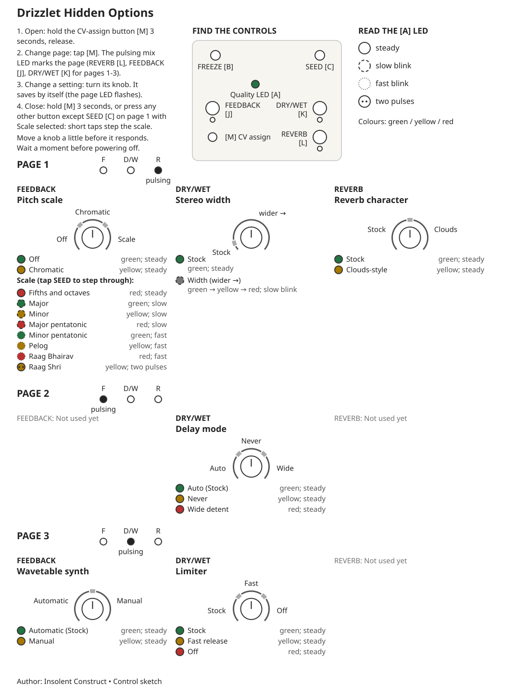

<!-- Author: Insolent Construct. Generated by options_guide.py. -->
# Options page

**TL;DR:** Hold ASSIGN for 3 seconds and release. Tap to change page;
move a mix knob to edit, then rest it for 1 second to save.

[Printable guide](options-guide.svg) · [Phone guide](options-guide-mobile.svg)

## Steps

1. Enter: hold ASSIGN alone 3 s with mix knobs still, then release.
2. Next page: tap ASSIGN. Pages cycle 1 → 2 → 3 → 1.
3. Leave: hold ASSIGN 3 s or press another button (SEED exception below).
4. Save: rest the knob 1 s; the page LED flashes briefly (100 ms).
5. Pending edits save after leaving too. Wait 1 s before powering off.
6. Move a knob more than 10% to begin editing. Reserved knobs do nothing.
7. MEDIA shows the first setting on entry, then the last qualified knob moved.
8. No idle exit or cancel. Reopening remembers the page until power-off.

## Reading the controls

Arc numbers match values below (CCW to CW); edges have a 3% dead band.
Pitch: Off / Chromatic / Scale in thirds. On Scale, tap SEED to cycle
the eight scales below in order. Holds do not cycle; taps do not play grains.
Width: Stock below 10%; leave above 13%, return below 7%.
Enabled width runs from zero spread at 13% to full spread at 100%.
Zero preserves stereo position (mono centred); changes affect new grains.
All three mix LEDs pulse on entry; one marks the page thereafter.
The page LED flashes on entry, exit and after saving changed values.

## MEDIA LED legend

MEDIA: solid ring = steady; dashed ring = slow ≈1 Hz; dotted ring = fast ≈4 Hz.
Two dots = two yellow pulses then a pause (2.048 s group). Colour is also named.
Width meter: slow green → yellow → red for zero → full enabled spread.
First value = steady green. Reserved = MEDIA unchanged. Page LED ≠ MEDIA.

## Page 1 — REVERB LED pulses

| Knob | Setting | Zone (CCW → CW) |
|---|---|---|
| FEEDBACK | Pitch scale | 0–33.3%: Off; 33.3–66.7%: Chromatic; 66.7–100%: Scale: tap SEED |
| DRY/WET | Stereo width | 0–10%: Stock; 10–100%: Width 0 → full |
| REVERB | Reverb character | 0–50%: Stock; 50–100%: Clouds-style |

| Page | Knob | Value | MEDIA LED |
|---|---|---|---|
| 1 | FEEDBACK | Off | green; steady |
| 1 | FEEDBACK | Chromatic | yellow; steady |
| 1 | FEEDBACK | Fifths and octaves | red; steady |
| 1 | FEEDBACK | Major | green; slow (0.98 Hz) |
| 1 | FEEDBACK | Minor | yellow; slow (0.98 Hz) |
| 1 | FEEDBACK | Major pentatonic | red; slow (0.98 Hz) |
| 1 | FEEDBACK | Minor pentatonic | green; fast (3.91 Hz) |
| 1 | FEEDBACK | Pelog | yellow; fast (3.91 Hz) |
| 1 | FEEDBACK | Raag Bhairav | red; fast (3.91 Hz) |
| 1 | FEEDBACK | Raag Shri | yellow; 2 yellow pulses / 2.048 s |
| 1 | DRY/WET | Stock | green; steady |
| 1 | DRY/WET | Enabled (1..255) | green → yellow → red meter; slow (0.98 Hz) |
| 1 | REVERB | Stock | green; steady |
| 1 | REVERB | Clouds-style | yellow; steady |

## Page 2 — FEEDBACK LED pulses

| Knob | Setting | Zone (CCW → CW) |
|---|---|---|
| FEEDBACK | Reserved | 0–100%: Reserved |
| DRY/WET | Delay mode | 0–33.3%: Auto (Stock); 33.3–66.7%: Never; 66.7–100%: Wide detent |
| REVERB | Reserved | 0–100%: Reserved |

| Page | Knob | Value | MEDIA LED |
|---|---|---|---|
| 2 | FEEDBACK | Reserved | unchanged |
| 2 | DRY/WET | Auto (Stock) | green; steady |
| 2 | DRY/WET | Never | yellow; steady |
| 2 | DRY/WET | Wide detent | red; steady |
| 2 | REVERB | Reserved | unchanged |

## Page 3 — DRY/WET LED pulses

| Knob | Setting | Zone (CCW → CW) |
|---|---|---|
| FEEDBACK | Self-play | 0–50%: Automatic (Stock); 50–100%: On request |
| DRY/WET | Limiter | 0–33.3%: Stock; 33.3–66.7%: Fast release; 66.7–100%: Off |
| REVERB | Reserved | 0–100%: Reserved |

| Page | Knob | Value | MEDIA LED |
|---|---|---|---|
| 3 | FEEDBACK | Automatic (Stock) | green; steady |
| 3 | FEEDBACK | On request | yellow; steady |
| 3 | DRY/WET | Stock | green; steady |
| 3 | DRY/WET | Fast release | yellow; steady |
| 3 | DRY/WET | Off | red; steady |
| 3 | REVERB | Reserved | unchanged |

## What changes

Pitch snaps new grains to the selected scale; playing grains keep their pitch.
The continuous synth oscillator and delay pitch keep their usual behaviour.
Pelog and the raags are microtonal. The root is unity (0 semitones).

Width sets random pan spread for new grains. When enabled, normal ASSIGN
cycling adds WIDTH after the three mix destinations; all three LEDs pulse.
ASSIGN CV adds to the saved width and clamps at zero and full spread.

Reverb selects Stock or Clouds-style. Switching briefly fades and clears the tail.
Delay Auto switches at SIZE fully clockwise; Never stays granular.
Wide detent adds an unfiltered 40–60% zone to SIZE attenurandomizer plus
SIZE CV and removes resonant boost; synth mode is unaffected.

Self-play Automatic starts as usual. On request requires both inputs unpatched
and FREEZE off: hold MEDIA 1.5 s to start or stop. Patching an input stops it
once FREEZE is off. Limiter Off allows loud peaks to hard-clip.
