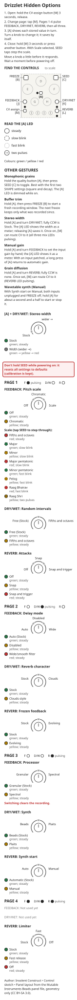

# Drizzlet

Alternative firmware for Mutable Instruments Beads, built on the vanilla Mutable Instruments source; not a Mutable Instruments product.

**TL;DR:** Beta 1 "Mist", a call for testers. New since alpha 2: buffer trim, pitch scales, Clouds-style reverb, stereo width and delay mode, on an options page that saves by itself. New settings default to stock behaviour. The grain engine needs about 6,900 fewer cycles per block in the heaviest stock case, with the same sound.

Tested on one module so far. Please report problems, and what works, in [this repository's issues](https://github.com/insolentconstruct/eurorack/issues); do not contact Mutable Instruments. [TESTING.md](docs/TESTING.md) shows how it was tested.

What's planned: the [roadmap](https://github.com/insolentconstruct/eurorack/issues/32). Most requested features: [feature requests](https://github.com/insolentconstruct/eurorack/issues/130).

From the [Mutable Instruments eurorack README](https://github.com/pichenettes/eurorack/blob/master/README.md):

> Code provided as is, builds on a Desktop platform but not verified to build and run on a module. Install at your own risks.

Install at your own risk.

## Quick start

Buttons use the letters from the Beads manual: [A] is the quality button, and [M] is the CV-assign button below the FEEDBACK [J] knob (CV input 7).

Hold the CV-assign button [M] for three seconds, then release, to open the options page. Tap [M] to change page; move a mix knob and rest it for one second to save. Guides: [text](docs/OPTIONS.md), [printable](docs/options-guide.svg).



## Downloads

From [GitHub Releases](https://github.com/insolentconstruct/eurorack/releases):

- `<tag>-wav.zip`: audio update, with `README.txt`, `NOTICE.txt` and the options guides.
- `<tag>-combo.zip`: bootloader + app for ST-Link recovery, as `.hex` and `.bin`.
- `<tag>-combo.hex`: the same image on its own.
- `options-guide.svg`, `options-guide-mobile.svg` and `OPTIONS.md`: the options guides, also on their own.

Module manual: [Beads manual](https://pichenettes.github.io/mutable-instruments-documentation/modules/beads/manual/) and [development history](https://pichenettes.github.io/mutable-instruments-documentation/trivia_and_history/beads_history/). Changes, including against older firmware back to the factory release: [CHANGELOG.md](CHANGELOG.md). Where the manual and the firmware disagree: [MANUAL_ERRATA.md](docs/MANUAL_ERRATA.md).

Developers: [STYLE.md](docs/STYLE.md), [OPTIMIZATIONS.md](docs/OPTIMIZATIONS.md), [PORTING.md](docs/PORTING.md), and [FEATURES.md](docs/FEATURES.md) (which buttons, settings bytes, flash and RAM are taken). Starting your own firmware? [`beads-build-kit`](https://github.com/insolentconstruct/eurorack/tree/beads-build-kit) builds the vanilla source unmodified. [`beads-tuneup`](https://github.com/insolentconstruct/eurorack/tree/beads-tuneup) adds the bug fixes, the GCC 9 build kit and the CPU optimizations, without Drizzlet's features; see its [README-BASE.md](https://github.com/insolentconstruct/eurorack/blob/beads-tuneup/README-BASE.md).

## Delay mode

This is the manual's delay or beat slicer, which turns on at SIZE fully clockwise.
On page 2 (DRY/WET LED), FEEDBACK selects Auto (Stock) / Disabled /
Wide/smooth filter in thirds. Auto (Stock) keeps the usual switch to delay at SIZE fully
clockwise. Disabled keeps granular playback there. Wide/smooth filter keeps the switch
and makes the delay filter neutral in the middle of its range, with no
resonant boost at either end. The filter is controlled by the SIZE
attenurandomizer and SIZE CV. The quality LED [A] shows steady green / yellow / red.
The setting is saved and defaults to Auto (Stock). It does not affect wavetable synth mode.

## Stereo width

Hold [A] and turn DRY/WET to set the stereo width of the grains; releasing
[A] saves it. At the bottom of the knob it is Stock; turn it up a little to
switch width on. Turning clockwise spreads the grains wider, up to a full
random spread fully clockwise. At the lowest width the input stereo position
passes through and mono stays centred. Width randomizes every grain, even at
DENSITY fully clockwise. Each grain's pan is fixed when it starts, so changes
affect new grains only, including synth.
While you turn, the [A] LED shows the width as a meter, from green through
yellow to red. A tap of [A] without turning DRY/WET still changes the
recording quality.
When width is on, short [M] presses cycle the three stock destinations, then
WIDTH; all three mix LEDs pulse together for WIDTH. Custom mix assignment
still works. The assignable CV input (7) adds to the width. Stock keeps the
stock cycle and pan rounding.

## Monophonic grains

Hold [A] first, then press SEED to toggle monophonic grains. The setting
is saved and defaults off; the [A] LED is dimmed when on. This is Mutable
Instruments' original code and gesture: each new grain fades the previous
grains out. It suits the square and decay SHAPE settings. Slower shapes can go
nearly silent. To recover sound, switch to square or decay, reduce the trigger
rate, shorten SIZE, or toggle monophonic grains off. Turn them off before
downgrading to stock firmware.

## Buffer trim

Hold [A] first, then press FREEZE to start a new recording window from
zero length and clear the FREEZE button latch. Release both buttons, record
the length you want, then freeze. A FREEZE gate keeps the window empty until
it goes low. Grains already playing finish normally.
Frozen-buffer saves keep the trimmed length; stock firmware loads them at full
length. The gesture comes from Mutable Instruments' disabled buffer-trim code.

## When the buffer is cleared

FREEZE never clears the recording buffer: releasing it resumes recording
where it stopped, with a short crossfade. As on stock firmware, the buffer
starts empty after changing the recording quality, switching between mono and
stereo input (for example, patching or unpatching IN R while IN L is
patched), leaving the wavetable synth, or
powering up without a saved frozen buffer. Buffer trim restarts the recording
window without erasing the old audio; grains already playing finish on it,
and new grains read only the new window.

## Frozen-buffer autosave

A frozen buffer is saved after FREEZE has been on for ten seconds. A save cut
short (by releasing FREEZE, for example) doubles the next wait, up to a cap,
until a save completes or FREEZE has been off for a minute; power-up resets the
wait. If FREEZE is released during wavetable synth, the minute starts when
wavetable synth ends.

## Options page

Visual and text guides: OPTIONS.md, options-guide.svg (printable) and
options-guide-mobile.svg (phone). They sit beside this README in the release
zips, and in docs/ in the source download.

Hold the CV-assign button [M] alone for three seconds with the mix knobs still; then release.
Tap [M] to change page. The pages light the mix LEDs left to right: page 1
(FEEDBACK LED), page 2 (DRY/WET LED), page 3 (REVERB LED), page 4 (all three
LEDs). The page LED pulses slowly. Reopening returns to the last page until
power-off; power-up starts on page 1.
When a page opens, [A] shows each stored value in turn, left to right, for
about two seconds each, with that knob's LED lit steady. Turning a knob, or
tapping SEED to step the scale, ends this. [A] then shows the first setting
on the page, then the last knob you took over. A knob must move a little
before it takes over. Knobs marked Not used yet do nothing.

Page / pulsing LED  FEEDBACK      DRY/WET           REVERB
1 / FEEDBACK        Pitch scale   Random intervals  Attacks
2 / DRY/WET         Delay mode    Reverb character  Frozen feedback
3 / REVERB          Processor     Synth             Synth start
4 / all three       Not used yet  Not used yet      Limiter

Changes save by themselves about a second after you stop turning; wait that
long before powering off. Close by holding [M] for three seconds or pressing
another button. Mix controls then catch up smoothly. On page 1 with Scale
selected, short SEED taps step the scale instead of closing.
Every first value, including Pitch Off, is steady green. Other values follow
yellow, red, then green/yellow/red slow and fast blinking. Raag Shri uses two yellow pulses then a pause.
The page LED flashes on entry, close and save. See [OPTIONS.md](docs/OPTIONS.md) for every value.

Output limiter: page 4 (all three LEDs), REVERB knob, in thirds. Stock is
steady green; Fast release is steady yellow; Off is steady red. With Off,
loud peaks can hard-clip.

Hygrostat profile options

Hygrostat can add the following options to a profile. They are off in the
standard firmware. Page settings appear at the knob chosen in Hygrostat;
turning and saving them works like the other options.

Version at boot gives a short light-blue Drizzlet flash followed by two
light-blue pulses for Beta 2, without delaying audio startup.
Delay indication flashes it red briefly when entering or leaving delay mode.
Pitch notch indication lights it green while the PITCH knob is on the unison
or an octave plateau, including the +/-2-octave knob ends, with a little
hysteresis at the edges. CV, random pitch and quantization do not affect it. These cues yield to options, warnings and manual meters.
Live assignment LEDs scale the stock patterns by the magnitude of assignable
CV, retaining distinct width/diffusion patterns and stock amount weighting. FREEZE during saves keeps the FREEZE LED at full
intensity while a frozen buffer is being saved.

Input attenuation extends [A]+FEEDBACK down to silence. Around noon the gain
snaps to unity; below it, the input is attenuated, and above it the input is
amplified. Automatic gain still works as usual and never attenuates. Hold [A]
to restart automatic gain. A saved manual gain uses the extended range as soon
as this feature is enabled. Stock never attenuates below unity: Mutable
Instruments kept unity as the minimum deliberately ("it's a sensitivity
setting"). The 120-136 unity band and green meter cue keep unity easy to find.

LED brightness offers 100% / 66% / 33%, Fixed via Hygrostat or Adjustable
in thirds of a selected options-page knob, with a live preview while turning.
Warnings dim too. Bright digital RGB white is balanced against the white LEDs
at the reduced levels; 100% is the release's own LEDs. The default is 100%.
SEED latch offers four values in quarters of the selected knob:
Off (stock divider with a patched cable), Ignore (free-running, cable ignored),
Sync (free-running; SEED edges restart grain-clock phase, useful on the
periodic side of DENSITY), Add (free-running; one extra grain per edge).
The divider is unavailable except in Off. These choices apply only while
latched with a cable patched; unpatched attack triggers keep working. Ignore
also suppresses trigger LED flashes. Synth grain clocks share these modes;
delay free-runs for all non-Off values. Hygrostat can fix any value or place
it in any options page slot.

TIME modulation offers Random in the lower half and Scan in the upper half.
With Scan and TIME CV unpatched, the TIME attenurandomizer moves the playback
position: noon stops, clockwise moves forwards, counter-clockwise backwards.
At either end it takes four seconds to scan the buffer. TIME offsets the
position, which wraps at the buffer boundary. Try it on a frozen recording.
Patching TIME CV restores its usual response and pauses the scan. Scan also
pauses in delay, spectral and synth modes. The position is not saved.

Processor: page 3 (REVERB LED), FEEDBACK knob. Lower half selects Granular
(Stock) (steady green); upper half selects Spectral (steady yellow).
Spectral replaces the grains with the spectral processing of Mutable
Instruments' Clouds. TIME picks the stored spectrum, SIZE warps it, SHAPE
quantizes it and PITCH shifts it (following the pitch scale). DENSITY sets how
quickly the spectrum is renewed, and scrambles its phases towards either end.
Holding SEED glitches it; FREEZE holds it. The attenurandomizers draw a new
value for each spectrum. FEEDBACK, DRY/WET, REVERB, the recording quality,
the assignable CV and the R gate output work as usual; there is no grain
diffusion, delay mode or wavetable synth.
A new processor takes over when the page closes: the sound fades out, the
recording is cleared, and the sound fades back in. A frozen buffer saved to
flash stays there and comes back with Granular. The setting is saved. Stock
firmware ignores it; saving after a downgrade resets it to Granular (Stock).

Synth: page 3 (REVERB LED), DRY/WET knob. Lower half selects
Beads (Stock) (steady green), the wavetable synth; upper half selects Plaits
(steady yellow): six voices of Mutable Instruments' Plaits play instead. Each
SEED trigger starts the next voice, which keeps its pitch and settings.
FEEDBACK picks one of the 24 models; TIME, SIZE and SHAPE set HARMONICS,
TIMBRE and MORPH, each note drawing its own random values; PITCH, DENSITY,
SEED, REVERB, quality, stereo width and the pitch scale work as in the
wavetable synth. DRY/WET sets the decay and FREEZE sustains. With DENSITY at
noon and SEED unpatched, the last voice drones until SEED plays a note. The
setting is saved; stock firmware ignores it.

Synth start: page 3 (REVERB LED), REVERB knob. Lower half selects Automatic
(Stock) (steady green): the synth starts after 10 s with both audio inputs
unpatched, as the Beads manual describes. Upper half selects Manual (steady
yellow): it never starts by itself. To start it by hand, unpatch both audio
inputs, turn FREEZE off and hold [A] for about a second and a half; hold
again to stop. Patching either input also stops it (once FREEZE is off);
with an input patched, the hold restarts automatic gain as usual. The
setting is saved; stock firmware ignores it.

Reverb character: page 2 (DRY/WET LED), DRY/WET knob. Lower half selects
Stock (default, steady green); upper half selects Clouds-style (steady yellow).
Clouds-style uses Mutable Instruments' Clouds reverb timings and modulation,
plus diffusion on the grain wet output until an amount is set with [A]+REVERB
(below). In delay and wavetable synth modes, only the reverb character changes. Switching briefly fades the sound out and
back in and clears the old tail. The setting is saved; stock firmware ignores
it and resets it to Stock when saving after a downgrade.

Random intervals: page 1 (FEEDBACK LED), DRY/WET knob. Lower half selects
Free (default, steady green); upper half selects Fifths and octaves (steady
yellow). With the PITCH attenurandomizer counter-clockwise, each grain's
random offset then lands on fifths and octaves around the knob's pitch;
clockwise it stays continuous. The pitch scale still applies. Grains and
synth grains only. The setting is saved; stock firmware ignores it.

Attacks: page 1 (FEEDBACK LED), REVERB knob, in thirds. Off (default,
steady green), Snap (steady yellow): while recording, Beads marks the attacks
in the input, and a grain that would start just after one starts on it
instead, so grains begin on a hit rather than partway through its decay.
Snap and trigger (steady red) also starts a grain on each attack, as a SEED
pulse would. Only granular playback uses the marks; a patched SEED still
works. The setting is saved; stock firmware ignores it.

Frozen feedback: page 2 (DRY/WET LED), REVERB knob. Lower half selects
Stock (default, steady green); upper half selects Evolving (steady yellow).
With Evolving, while FREEZE is on, the grains run through a slowly moving
all-pass loop, so the frozen sound drifts and its attacks soften instead of
repeating exactly; FEEDBACK sets how far it goes. It fades in and out
quickly and does nothing while FREEZE is off. The setting is saved; stock
firmware ignores it.

Grain diffusion: hold [A] and turn REVERB to set the amount, with either
reverb; the [A] LED shows it as a meter, and fully CCW is none. Until it is
set, Stock has none and Clouds-style keeps its own amount. Once an amount is
set, short presses of [M] add DIFFUSION after REVERB (and after WIDTH); the
REVERB LED pulses alone while it is the CV destination. Diffusion acts on the
grains only, not in delay or wavetable synth modes. The amount is saved; stock
firmware ignores it.

Pitch quantization: page 1 (FEEDBACK LED), FEEDBACK knob. Three zones
select Off (steady green), Chromatic (steady yellow), or Scale. In Scale,
tap SEED briefly to cycle Fifths and octaves (steady red), Major (slow green),
Minor (slow yellow), Major pentatonic (slow red), Minor pentatonic (fast green),
Pelog (fast yellow), Raag Bhairav (fast red), and Raag Shri (two yellow pulses
then a pause). Holds do not cycle. SEED taps here do not trigger or latch
grains; other buttons close the page. The setting is saved; default is Off.

Each grain's PITCH knob, CV and random offset snap together at its start,
on a grid rooted at the unshifted pitch; +1 V is still one octave.
Playing grains keep their pitch. Synth grains snap too; the continuous
synth oscillator and delay mode keep their existing pitch behaviour.
Scales use Mutable Instruments Marbles' tunings and notes with weight at
least 64 (Pelog has four notes). Major and Minor pentatonic are subsets
of its Major and Minor scales. Pelog and the raags are microtonal.

## Updating your module

Follow the [official Beads firmware update procedure](https://pichenettes.github.io/mutable-instruments-documentation/modules/beads/manual/#firmware); the full steps are in the zip's `README.txt`.

**Do not hold SEED at power-on unless you mean to: it resets the settings (a valid calibration is kept).**

### Damaged settings

Drizzlet keeps a copy of the calibration in the flash sector before the settings (0x081C0000). An unreadable or invalid calibration is restored from that copy without a word, and an interrupted save just loses that save, so a power cut while saving doesn't reset anything.

Only if the calibration and its copy are both lost does the module warn: all LEDs blink fast for 3 seconds at each power-up, then it plays on the factory calibration and default settings. Changes work until power-off but nothing is saved, and a frozen buffer is not restored.

To repair, power on while holding SEED. After a few seconds the LEDs show the result for 3 seconds:

- Green quality LED blinking, the three mix LEDs lit: repaired with the factory calibration. [Recalibrate](docs/CALIBRATION.md).
- Red quality LED and mix LEDs blinking fast: the repair failed, nothing was changed. Try again; if it keeps failing, use the storage recovery tool.

### Backup and restore

The settings sector holds the CV calibration and the settings. Back it up with ST-Link + OpenOCD; use a backup on the same unit only. Recalibrating the CV inputs: [CALIBRATION.md](docs/CALIBRATION.md).

```sh
openocd -f interface/stlink.cfg -f target/stm32h7x.cfg \
    -c "init; halt; dump_image beads-settings.bin 0x081E0000 0x20000; reset run; shutdown"
```

To restore, build an image with Python 3 from the backup and, for a partial restore, a dump of the sector as it is now (`beads-now.bin`, made with the backup command):

- **Both:** `python3 beads/build/tools/settings_sector.py --calibration beads-settings.bin --settings beads-settings.bin beads-restore.bin`
- **Calibration only**, keeping today's settings, e.g. to undo a recalibration: `python3 beads/build/tools/settings_sector.py --calibration beads-settings.bin --settings beads-now.bin beads-restore.bin`
- **Settings only**, keeping today's calibration: `python3 beads/build/tools/settings_sector.py --calibration beads-now.bin --settings beads-settings.bin beads-restore.bin`

Then write it:

```sh
openocd -f interface/stlink.cfg -f target/stm32h7x.cfg \
    -c "init; halt; flash write_image erase beads-restore.bin 0x081E0000; verify_image beads-restore.bin 0x081E0000; reset run; shutdown"
```

The image holds only the calibration and the latest settings. If the module showed the damaged-settings warning, restoring a backup this way also repairs it. OpenOCD erases the whole sector and programs just those, so later saves land on erased flash; don't write the 128 KB backup itself back. The tool refuses a dump the firmware would not read and never overwrites a file. To reset the settings to defaults instead, hold SEED while powering on; calibration is kept.

### ST-Link recovery

Back up calibration first, then flash the combo image from `<tag>-combo.zip`.
Erase only the sectors being written, as OpenOCD's `write_image erase` does.
Never use a full-chip or mass erase (STM32CubeProgrammer's "Full chip erase"): it also wipes calibration and settings.
The `.hex` carries its address, so STM32CubeProgrammer and most programmers need none; the `.bin` goes at 0x08000000. With OpenOCD, use your downloaded filename in place of `drizzlet-YYYY.MM.DD-combo.bin`:

```sh
openocd -f interface/stlink.cfg -f target/stm32h7x.cfg \
  -c "init; halt; flash write_image erase drizzlet-YYYY.MM.DD-combo.bin 0x08000000; verify_image drizzlet-YYYY.MM.DD-combo.bin 0x08000000; reset run; shutdown"
```

Older releases have no `.hex`; make one from the `.bin`:

```sh
arm-none-eabi-objcopy -I binary -O ihex --change-addresses 0x08000000 drizzlet-YYYY.MM.DD-combo.bin drizzlet-YYYY.MM.DD-combo.hex
```

## Saved data

The settings and frozen-buffer formats are frozen for Beta 1. Zero and unknown values select the stock behaviour. Stock firmware ignores the Drizzlet bytes and clears them when it saves, and loads trimmed buffers at full length. Turn monophonic grains off before downgrading. Byte layout: [FEATURES.md](docs/FEATURES.md).

## Building it yourself

On an amd64 host with Docker, run from the repository root:

```sh
git submodule update --init stmlib stm_audio_bootloader
docker build --platform linux/amd64 --target compiler -t beads-build-kit beads/build
bash beads/build/build.sh "$PWD/artifacts" --wav
```

The app is built with GCC 9.3.1; the bootloader keeps GCC 4.9.3 and its previous bytes. Builds verify the firmware and WAV hashes. CI also builds the vanilla app with GCC 4.9.3 as a golden reference (locally: `bash beads/build/golden.sh "$PWD/golden"`, needs a full Git checkout). Releases publish from `drizzlet-*` tags and include the tag's CHANGELOG.md section.

## License and credits

Code: MIT, from the Mutable Instruments source, with credits to Frédéric Meslin / Fred's Lab and Oliver Rockstedt; see [LICENSE](LICENSE).
The manual excerpt and hardware designs are licensed CC-BY-SA 3.0.
Copyright and permission notices are in `NOTICE.txt`; preserve them when redistributing.
