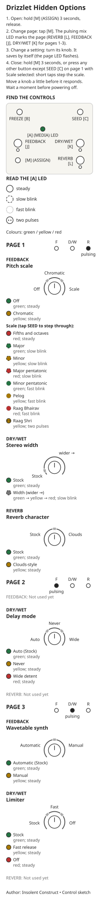

# Drizzlet

Alternative firmware for Mutable Instruments Beads, built on the released Mutable Instruments source; not a Mutable Instruments product.

**Beta 1 preparation:** module checks and outside testing are still pending. Please report any problems you find. [TESTING.md](TESTING.md) shows how it was tested.

From the [Mutable Instruments eurorack README](https://github.com/pichenettes/eurorack/blob/master/README.md):

> Code provided as is, builds on a Desktop platform but not verified to build and run on a module. Install at your own risks.

Install at your own risk. Please do not contact Mutable Instruments about it; report problems in [this repository's issues](https://github.com/insolentconstruct/eurorack/issues).

## Quick start

Hold ASSIGN for three seconds and release to enter. Tap ASSIGN to change
page; move a mix knob and rest it for one second to save.
See the [text guide](OPTIONS.md) and [printable guide](options-guide.svg).



## Downloads

Get the files from [GitHub Releases](https://github.com/insolentconstruct/eurorack/releases).

- `<tag>-wav.zip`: audio update, with `README.txt`, `NOTICE.txt` and the options guides.
- `<tag>-combo.zip`: bootloader + app for ST-Link recovery.

For the module itself, read the [Beads manual](https://pichenettes.github.io/mutable-instruments-documentation/modules/beads/manual/) and the [Beads development history](https://pichenettes.github.io/mutable-instruments-documentation/trivia_and_history/beads_history/).
What changed, including against older firmware: see [CHANGELOG.md](CHANGELOG.md).
Where the Beads manual and the firmware disagree, see [MANUAL_ERRATA.md](MANUAL_ERRATA.md).

Contributing code: follow [STYLE.md](STYLE.md). What the build changed to run faster, and how to propose more: [OPTIMIZATIONS.md](OPTIMIZATIONS.md). Building the DSP elsewhere: [PORTING.md](PORTING.md). Before adding a feature, check [FEATURES.md](FEATURES.md) for which buttons, settings bytes, flash and RAM are already taken.

**TL;DR:** buffer trim, pitch scales, Clouds-style reverb, stereo width and
delay mode are new since alpha 2. The new settings default to stock behaviour.

## Delay mode

On page 2 (FEEDBACK LED), DRY/WET selects Auto (Stock) / Never /
Wide detent in thirds. Auto (Stock) keeps the usual switch to delay at SIZE fully
clockwise. Never keeps granular playback there. Wide detent keeps automatic
switching and makes the delay filter neutral from 40% to 60% of its range,
with no resonant boost at either end. The filter is controlled by the SIZE
attenurandomizer and SIZE CV; its neutral sound is unfiltered. Outside the
neutral zone the remaining travel reaches the usual low-pass and high-pass
ends. The MEDIA LED shows steady green / yellow / red.
The setting is saved and defaults to Auto (Stock). It does not affect synth mode.

## Stereo width

On page 1 (REVERB LED), DRY/WET selects Stock below 10% (3% dead band).
Move out of Stock above 13%; return below 7%.
Above this zone it sets a continuous saved width: zero displacement at 13%
to full random spread at fully clockwise. At zero width the input stereo
positioning passes through and mono stays centred. Enabled width randomizes
every grain, including at DENSITY fully clockwise with no other randomness.
Pan is fixed at grain start; changes affect new grains only, including synth.
The MEDIA LED is steady green for Stock. Enabled width blinks slowly, using
Beads' green through yellow to red meter colour for the amount; adjacent saved
amounts can share a colour.
When enabled, short ASSIGN presses cycle the three stock destinations then
WIDTH; all three ASSIGN LEDs pulse together for WIDTH. The existing custom
mix assignment remains available. ASSIGN CV adds to resting width and clamps
to 0..1. Stock keeps the stock cycle and pan rounding.

## Monophonic grains

Hold MEDIA first, then press SEED to toggle monophonic grains; the setting
is saved and defaults off. The MEDIA/MEDIA LED is half as bright when on
(the recording reserve can dim it further). This enables Mutable Instruments'
original code and gesture. Each new grain fades the previous grains out.
It suits the square and decay SHAPE settings. Slower shapes can go nearly
silent because each new grain cuts the previous one's attack. To recover
sound, switch to square or decay, reduce the trigger rate, shorten SIZE,
or use the same gesture to turn monophonic grains off. Turn them off before
downgrading to stock firmware.

## Buffer trim

Hold MEDIA first, then press FREEZE to start a new recording window from
zero length and clear the FREEZE button latch. Release both buttons, record
the desired length, then freeze. A FREEZE gate keeps the window empty until
the gate goes low. Grains already playing finish normally.
Frozen-buffer saves keep the trimmed length. Stock firmware loads these
saves at full length. The gesture comes from Mutable Instruments' disabled
buffer-trim code.

## Frozen-buffer autosave

Autosave normally starts after FREEZE has been on for 10 seconds. A save cut
short after erasing doubles the next wait, up to 320 seconds, until a save
completes or FREEZE has been off for a minute; power-up starts at 10 seconds.
If FREEZE is released during self-play, the minute starts when self-play ends.

## Options page

Visual and text guides: OPTIONS.md, options-guide.svg (printable), and
options-guide-mobile.svg (phone). Find them beside this README in release
zips, or beside the build documentation in the source download.

Hold ASSIGN alone for three seconds with the mix knobs still; then release.
Tap ASSIGN to cycle page 1 (REVERB LED), page 2 (FEEDBACK LED), page 3
(DRY/WET LED), then page 1. The page LED pulses slowly. All three pulse
on entry. Reopening remembers the last page until power-off; power-up
starts on page 1. MEDIA shows the first available setting on each page,
then the last qualified knob moved. Move a knob more than 10% of its travel
before it edits. Knobs marked Not used yet do nothing, including to MEDIA and saving.

Page / pulsing LED  FEEDBACK      DRY/WET       REVERB
1 / REVERB          Pitch scale   Stereo width  Reverb character
2 / FEEDBACK        Not used yet  Delay mode    Not used yet
3 / DRY/WET         Self-play     Limiter       Not used yet

Changes are saved after one second without qualified knob movement or a
value change. A sweep through zones saves once when it settles. Close by
holding ASSIGN for three seconds or pressing another button; there is no
idle close or cancel. On page 1 with Scale selected, short SEED taps step
the scale instead of closing options. A pending change still saves after closing: wait one second
before powering off. Mix controls resume with smooth catch-up after closing.
Guide arcs and shaded switching bands are generated from the firmware
export; the zone descriptions are checked against that same export.
Every first value, including Pitch Off, is steady green. Other values follow
yellow, red, then green/yellow/red slow and fast blinking. Slow is about 1 Hz;
fast is about 4 Hz. Raag Shri uses two yellow pulses then a pause.
The page LED flashes for 100 ms on entry, close and after a changed batch is
written. MEDIA keeps showing the value. See the reference for every value.

On page 1 (REVERB LED), DRY/WET selects Stock below 10% (3% dead band).
Move out of Stock above 13%; return below 7%.
Above this zone it sets a continuous saved width: zero displacement at 13%
to full random spread at fully clockwise. At zero width the input stereo
positioning passes through and mono stays centred. Enabled width randomizes
every grain, including at DENSITY fully clockwise with no other randomness.
Pan is fixed at grain start; changes affect new grains only, including synth.
The MEDIA LED is steady green for Stock. Enabled width blinks slowly, using
Beads' green through yellow to red meter colour for the amount; adjacent saved
amounts can share a colour.
When enabled, short ASSIGN presses cycle the three stock destinations then
WIDTH; all three ASSIGN LEDs pulse together for WIDTH. The existing custom
mix assignment remains available. ASSIGN CV adds to resting width and clamps
to 0..1. Stock keeps the stock cycle and pan rounding.
Delay mode: Auto (Stock) keeps the usual delay switch at SIZE fully clockwise.
Never keeps granular playback there. Wide detent keeps the switch, with
an unfiltered zone from 40% to 60% on the delay filter (SIZE attenurandomizer
plus SIZE CV) and no resonant boost. It does not affect synth mode.
For delay mode, the MEDIA LED shows steady green / yellow / red
for Auto (Stock) / Never / Wide detent.

Output limiter: Stock is steady green; Fast release is steady yellow;
Off is steady red. With Off, loud peaks can hard-clip.
Self-play: page 3 (DRY/WET LED), FEEDBACK knob. Lower half selects Automatic (Stock)
(steady green); upper half selects On request (steady yellow).
Move more than 10% of its travel to begin; the midpoint
has a small dead band to prevent flicker.
With On request, self-play never starts by itself. With both audio inputs
unpatched and FREEZE off, hold MEDIA for 1.5 seconds to start self-play;
hold again to stop. Patching either input also stops it (once FREEZE is off).
With an input patched, the hold restarts automatic gain as usual.
Automatic (Stock) keeps stock behaviour.
The setting is saved. Stock firmware ignores it; saving after a downgrade
resets it to Automatic (Stock).

Reverb character: page 1 (REVERB LED), REVERB knob. Lower half selects
Stock (default, steady green); upper half selects Clouds-style (steady yellow).
Move more than 10% of its travel to begin; the midpoint
has a small dead band. The MEDIA LED shows the last knob moved on this page.
Clouds-style uses Mutable Instruments' Clouds reverb timings and modulation,
plus fixed diffusion on the grain wet output. In delay and self-play modes,
only the reverb character changes. Switching briefly fades the sound out and
back in and clears the old tail. The setting is saved; stock firmware ignores
it and resets it to Stock when saving after a downgrade.

Pitch quantization: Reverb LED page, FEEDBACK knob. Three zones
select Off (steady green), Chromatic (steady yellow), or Scale. In Scale,
tap SEED briefly to cycle Fifths and octaves (steady red), Major (slow green),
Minor (slow yellow), Major pentatonic (slow red), Minor pentatonic (fast green),
Pelog (fast yellow), Raag Bhairav (fast red), and Raag Shri (two yellow pulses
then a pause). Holds do not cycle. SEED taps here do not trigger or latch
grains; other buttons close the page. The setting is saved; default is Off.

Each grain's PITCH knob, CV and random offset snap together at its start.
The grid has a fixed root at unity (0 semitones); +1 V remains one octave.
Playing grains keep their pitch. Synth grains snap too; the continuous
synth oscillator and delay mode keep their existing pitch behaviour.
Scales use Mutable Instruments Marbles' tunings and notes with weight at
least 64, including four-note Pelog. Major and Minor pentatonic are subsets
of its Major and Minor scales.
Pelog and the raags are microtonal.

## Updating your module

Follow the [official Beads firmware update procedure](https://pichenettes.github.io/mutable-instruments-documentation/modules/beads/manual/#firmware); the full steps are in the zip's `README.txt`.

**Do not hold SEED at power-on unless you mean to: it resets the settings (a valid calibration is kept).**

### Calibration backup and restore

Back up the settings/calibration sector with ST-Link + OpenOCD (same unit only):

```sh
openocd -f interface/stlink.cfg -f target/stm32h7x.cfg \
    -c "init; halt; dump_image beads-settings.bin 0x081E0000 0x20000; reset run; shutdown"
```

Restore the backup to the same unit only:

```sh
openocd -f interface/stlink.cfg -f target/stm32h7x.cfg \
    -c "init; halt; flash write_image erase beads-settings.bin 0x081E0000; verify_image beads-settings.bin 0x081E0000; reset run; shutdown"
```

### ST-Link recovery

Back up calibration first, then flash the combo `.bin` from `<tag>-combo.zip`; this command doesn't touch the settings sector.

Use your downloaded filename in place of `drizzlet-YYYY.MM.DD-combo.bin`:

```sh
openocd -f interface/stlink.cfg -f target/stm32h7x.cfg \
  -c "init; halt; flash write_image erase drizzlet-YYYY.MM.DD-combo.bin 0x08000000; verify_image drizzlet-YYYY.MM.DD-combo.bin 0x08000000; reset run; shutdown"
```

## Saved data

The settings and frozen-buffer format below are frozen for Beta 1. Off,
Automatic (Stock) and Stock keep the stock behaviour; zero and unknown option values
select those defaults.

Byte 12/13 values are frozen at Beta 1. Future options use a free byte
17–22, with 0 meaning the Beta 1 behaviour so existing saves stay valid.

Width uses byte 14: 0 is Stock; 1..255 encode enabled width from zero to full.
WIDTH assignment uses byte 16: 0 is unassigned, 1 is assigned; other values
are unassigned. Stock sees FEEDBACK and clears these extensions on save.

Settings offsets are bytes in the 24-byte State payload:

| Byte | Setting | Saved values | Stock firmware |
|---|---|---|---|
| 10 | Limiter | 0 Stock, 0xA1 Fast release, 0xA2 Off; unknown → Stock | Ignores; clears to 0 on save |
| 11 | Self-play | 0 Automatic (Stock), 0xA1 On request; unknown → Automatic (Stock) | Ignores; clears to 0 on save |
| 12 | Pitch scale | 0 Off, 0xA1 Chromatic, 0xA2 Fifths and octaves, 0xA3 Major, 0xA4 Minor, 0xA5 Major pentatonic, 0xA6 Minor pentatonic, 0xA7 Pelog, 0xA8 Raag Bhairav, 0xA9 Raag Shri; unknown → Off | Ignores; clears to 0 on save |
| 13 | Reverb | 0 Stock, 0xA2 Clouds-style; all other values, including reserved 0xA1, → Stock | Ignores; clears to 0 on save |
| 14 | Stereo width | 0 Stock; 1..255 enabled width, zero to full spread | Ignores; clears to 0 on save |
| 15 | Delay mode | 0 Auto (Stock), 0xA1 Never, 0xA2 Wide detent; unknown → Auto (Stock) | Ignores; clears to 0 on save |
| 16 | WIDTH assignment | 0 unassigned, 0xA1 assigned; unknown → unassigned | Sees FEEDBACK; clears extension on save |

Monophonic grains use the original byte 9 (0 off, 1 on). Stock retains this
byte but compiles out the gesture, so turn mono off before downgrading.

The frozen-buffer header is 32 bytes, little-endian. Bytes 20–23 hold an
unsigned 32-bit count of frames removed from the full buffer, not the remaining
length: 0 means full length; the full frame count means empty. The count must
not exceed the full length for the saved quality and mono/stereo mode. It is
covered by the audio/header CRC and read only with the CRC1 tag in bytes
16–19. Alpha 1 and 2 wrote zero here; untagged older saves load at full length.
Stock reads only bytes 0–9 and loads a trimmed save at full length. Stock
rewrites do not preserve the trimmed length. Bytes 24–31 remain reserved and
are written as zero. The audio payload and header size are unchanged.

## Building it yourself

On an amd64 host with Docker, run from the repository root:

```sh
git submodule update --init stmlib stm_audio_bootloader
docker build --platform linux/amd64 --target compiler -t beads-build-kit beads/build
bash beads/build/build.sh "$PWD/artifacts" --wav
```

The app is built with GCC 9.3.1; the bootloader keeps GCC 4.9.3 and its
previous bytes. Both compiler archives are pinned.

Builds verify the firmware and WAV hashes. CI also builds the unchanged
released app with GCC 4.9.3 as a fixed golden reference, and checks WAV
decoding. Releases publish from `drizzlet-*` tags; the release notes include
the tag's CHANGELOG.md section, and publishing stops if it is missing.

To build the golden reference locally (needs a full Git checkout):

```sh
bash beads/build/golden.sh "$PWD/golden"
```

## License and credits

Code: MIT, from the Mutable Instruments source, with credits to Frédéric Meslin / Fred's Lab and Oliver Rockstedt; see [LICENSE](LICENSE).
The manual excerpt and hardware designs are licensed CC-BY-SA 3.0.
Copyright and permission notices are in `NOTICE.txt`; preserve them when redistributing.
